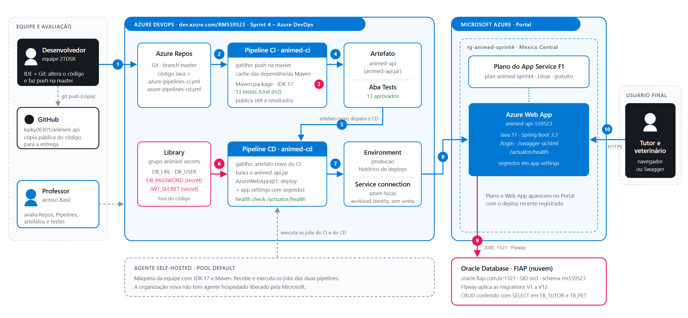

# Animed API

API REST e painel web de **cuidado contínuo e gamificação para pets**. Animed é a solução da equipe para o Challenge da Clyvo VET (FIAP 2026, turma 2TDSR).

| Disciplina | Onde está |
|------------|-----------|
| **DevOps Tools & Cloud Computing, Sprint 4**: CI/CD no Azure DevOps | [abaixo](#sprint-4--devops-tools--cloud-computing) |
| **Java Advanced, Sprint 4**: app online, frontend, Spring Security, Flyway, fluxos e integração | [seção Java Advanced](#java-advanced) |
| DevOps Sprint 3 (ACR + ACI), histórico | [docs/SPRINT3-DEVOPS.md](docs/SPRINT3-DEVOPS.md) |

---

# Sprint 4 — DevOps Tools & Cloud Computing

| | |
|---|---|
| Projeto no Azure DevOps | https://dev.azure.com/RM559523/Sprint%204%20%E2%80%93%20Azure%20DevOps |
| Repositório GitHub | https://github.com/kaiky06301/animed-api |
| Aplicação publicada | https://animed-api-559523.azurewebsites.net/login |
| Swagger | https://animed-api-559523.azurewebsites.net/swagger-ui.html |
| Diagrama | [docs/diagrama-cicd.png](docs/diagrama-cicd.png) · [versão com legenda](docs/diagrama-cicd.html) |

## 1. Descrição da solução

A jornada de saúde do pet costuma ser **episódica e reativa**: o tutor só procura a clínica quando o problema já aconteceu e some entre um evento e outro. O Animed transforma isso em cuidado contínuo. **Cada ato de cuidado (vacina, consulta, peso atualizado, medicação) vira pontos, os pontos viram nível e o nível vira desconto real em pet shops parceiros.**

A aplicação tem duas frentes:

- **API REST** com JWT para tutores, pets, vacinas, consultas, medicamentos, pet shops e pontuação, documentada no Swagger.
- **Painel web** com uma área do tutor (pontos, pets, agendamento) e uma área do veterinário (agenda, ficha clínica, conclusão de atendimento).

Nesta sprint o foco é a **esteira de CI/CD**: cada push na `master` do Azure Repos compila, roda os testes, publica o artefato e faz o deploy sozinho no Azure Web App, ligado ao Oracle da FIAP.

### Stack

| Camada | Tecnologia |
|--------|------------|
| Linguagem | Java 17 |
| Framework | Spring Boot 3.3.4: Web, Data JPA, Security (JWT + formulário), Validation, Cache (Caffeine), Actuator |
| Visualização | Thymeleaf + CSS próprio |
| Documentação da API | SpringDoc OpenAPI (Swagger UI) |
| Banco em nuvem | **Oracle Database da FIAP** (`oracle.fiap.com.br:1521`, SID `orcl`) |
| Migrations | Flyway (V1 a V12) |
| Build e testes | Maven + JUnit 5 + Mockito (H2 em memória só nos testes) |
| Repositório | Azure Repos (Git, branch `master`), com cópia pública no GitHub |
| CI/CD | Azure Pipelines em YAML (`azure-pipelines-ci.yml` e `azure-pipelines-cd.yml`) |
| Execução dos jobs | Agente self-hosted, pool `Default` |
| Hospedagem | Azure App Service: Web App Linux Java 17, plano F1 |
| Segredos | Library do Azure DevOps (grupo de variáveis `animed-secrets`, valores marcados como secret) |

## 2. Arquitetura e fluxo CI/CD



| # | O que acontece | Ferramenta |
|---|----------------|------------|
| 1 | O desenvolvedor altera o código na IDE e faz `git push` na `master` | IDE + Git → Azure Repos |
| 2 | O push dispara sozinho a pipeline de CI | Azure Pipelines (`animed-ci`) |
| 3 | O agente compila com JDK 17 e roda os **13 testes JUnit** | Maven + JUnit no agente self-hosted |
| 4 | O CI publica o artefato `animed-api` (o JAR) e os resultados dos testes | Pipeline Artifacts + aba Tests |
| 5 | O artefato novo dispara a pipeline de CD | Azure Pipelines (`animed-cd`) |
| 6 | O CD lê usuário, senha do banco e segredo JWT do grupo protegido | Library `animed-secrets` |
| 7 | O deploy passa pelo environment `producao` e usa a service connection | Environment + service connection por workload identity |
| 8 | O JAR é publicado no Web App e o CD confere o `/actuator/health` | AzureWebApp@1 → Azure Web App |
| 9 | A aplicação conecta no Oracle e o Flyway aplica as migrations | JDBC → Oracle FIAP |
| 10 | Tutor e veterinário usam a aplicação por HTTPS | Navegador / Swagger |

## 3. Banco de dados em nuvem

Oracle da FIAP, schema `rm559523`. O Flyway cria e versiona as tabelas (`src/main/resources/db/migration`). Como esse schema já tinha tabelas de outras disciplinas, o CD passa `SPRING_FLYWAY_BASELINE_VERSION=0`: assim o Flyway adota o schema sem pular a V1.

Tabelas usadas no CRUD do vídeo: **TB_TUTOR** (1) → **TB_PET** (N).

```sql
SELECT ID_TUTOR, NOME, EMAIL, TELEFONE FROM TB_TUTOR ORDER BY ID_TUTOR;
SELECT ID_PET, NOME, ESPECIE, RACA, PESO_KG, ID_TUTOR FROM TB_PET ORDER BY ID_PET;
```

## 4. Projeto no Azure DevOps

| Campo | Valor |
|-------|-------|
| Project name | Sprint 4 – Azure DevOps |
| Description | Projeto para entrega da Sprint 4 do professor João Carlos Menk, com os integrantes (RM - nome - turma) |
| Visibility | Private |
| Version control | Git |
| Work item process | Scrum |
| Professor | João Carlos Menk, convidado com acesso **Basic** |

## 5. Pipelines

### CI (`azure-pipelines-ci.yml`, pipeline `animed-ci`)

- **Gatilho:** qualquer push na branch `master`.
- **Cache Maven:** reaproveita as dependências entre execuções.
- **Maven package (JDK 17):** compila, roda os testes e gera `target/animed-api.jar`.
- **Testes:** os relatórios do Surefire são publicados na aba **Tests** da execução.
- **Artefato:** o JAR é publicado como `animed-api` no próprio Azure DevOps.

### CD (`azure-pipelines-cd.yml`, pipeline `animed-cd`)

- **Gatilho:** conclusão do CI com artefato novo (`resources.pipelines`), sem ação manual.
- **Baixar artefato:** pega o `animed-api.jar` gerado pelo CI.
- **Deploy (AzureWebApp@1):** publica no Web App `animed-api-559523` e grava as app settings (perfil `oracle`, URL, usuário e senha do banco, segredo JWT).
- **Health check:** espera até 5 minutos o `/actuator/health` responder 200. Se não responder, o deploy falha.

### Variáveis protegidas

Nenhum usuário, senha ou token está no código nem nos YAMLs. Tudo vem do grupo **`animed-secrets`** da Library:

| Variável | Tipo |
|----------|------|
| `DB_URL` | variável |
| `DB_USER` | variável |
| `DB_PASSWORD` | **secret** (mascarada nos logs) |
| `JWT_SECRET` | **secret** (mascarada nos logs) |

A conexão com a Azure (`azure-lucas`) usa **workload identity federation**: não há senha de service principal guardada em lugar nenhum.

## 6. Recursos na Azure

| Recurso | Nome |
|---------|------|
| Resource group | `rg-animed-sprint4` (Mexico Central) |
| Plano do App Service | `plan-animed-sprint4` (Linux, F1) |
| Web App | `animed-api-559523` (Java 17) |

## 7. Roteiro do vídeo

Antes de gravar, ligue o agente (`run.cmd` na pasta do agente) e deixe abertos a IDE, o Azure DevOps, o Portal da Azure, o banco (SQL Developer ou SQLcl) e o Swagger.

1. **Ferramentas:** mostre a IDE, o projeto no Azure DevOps (Repos, Pipelines, Library), o Portal e o banco.
2. **Configuração:** abra os dois YAMLs e explique cada stage, job e task (seção 5).
3. **Mudança visível no código, nunca no README:** troque, por exemplo, a frase da tela de login em `src/main/resources/templates/login.html` (`Cuidado contínuo para o seu pet`). Faça commit e push na `master`.
4. **CI automático:** mostre a execução começando sozinha. Abra os detalhes e comente cada etapa.
5. **Artefato e testes:** mostre o artefato `animed-api` e a aba **Tests** com os 13 aprovados.
6. **CD automático:** mostre o CD começando ao fim do CI. Comente o download, o deploy e o health check.
7. **Portal:** abra o Web App `animed-api-559523` e mostre o deploy recente (Deployment Center ou Log stream).
8. **App com a alteração:** abra `/login` e mostre a frase nova.
9. **CRUD com SELECT:** no Swagger, faça login (`POST /api/auth/login` com `doutor@animed.com.br` / `animed123`), autorize o token e rode o SELECT depois de cada operação:

| # | Operação | Prova no banco |
|---|----------|----------------|
| 1 | `GET /api/tutores` e `GET /api/pets` | SELECT mostra as mesmas linhas |
| 2 | `POST /api/tutores` | Linha nova em TB_TUTOR |
| 3 | `POST /api/pets` com o `idTutor` criado | Linha nova em TB_PET apontando para o tutor |
| 4 | `PUT /api/tutores/{id}` (telefone) | Telefone mudou |
| 5 | `PUT /api/pets/{id}` (peso) | Peso mudou |
| 6 | `DELETE /api/pets/{id}` e depois `DELETE /api/tutores/{id}` | As linhas sumiram |

```json
POST /api/tutores
{ "nome": "Marcos Ferreira", "email": "marcos.ferreira@animed.com.br",
  "cpf": "318.444.190-07", "telefone": "(11) 98822-4410" }
```

```json
POST /api/pets
{ "nome": "Bidu", "especie": "CACHORRO", "sexo": "MACHO", "raca": "Beagle",
  "dataNascimento": "2021-08-09", "pesoKg": 12.4, "castrado": true,
  "observacoesSaude": "Alergia a frango", "idTutor": 0 }
```

Troque o `idTutor` pelo id do tutor criado no passo 2.

> No plano F1 a primeira requisição depois de um tempo parado demora para acordar o Java. Abra o `/actuator/health` um minuto antes de começar o CRUD.

---

# Java Advanced

## Acesso à aplicação online

| | |
|---|---|
| Painel web | https://animed-api-559523.azurewebsites.net/login |
| Swagger | https://animed-api-559523.azurewebsites.net/swagger-ui.html |
| Health check | https://animed-api-559523.azurewebsites.net/actuator/health |

| Perfil | E-mail | Senha | Entra em |
|--------|--------|-------|----------|
| Tutor | `tutor@animed.com.br` | `animed123` | `/painel/tutor` |
| Veterinário | `doutor@animed.com.br` | `animed123` | `/painel/veterinario` |

## O problema e a solução

A jornada de saúde do pet é **episódica e reativa**: o tutor procura a clínica quando o problema já aconteceu e some entre um evento e outro. O pet adoece por prevenção esquecida e a clínica perde recorrência.

O Animed transforma isso em cuidado contínuo por gamificação: **cada ato de cuidado vira pontos, os pontos viram nível, e o nível vira desconto real em pet shops parceiros**.

## Camada de visualização

Painel web em **Thymeleaf**, com folha de estilo própria (`static/css/animed.css`). Duas áreas distintas, cada uma com suas telas:

| Área | Telas |
|------|-------|
| **Tutor** | painel com pontos e nível, meus pets, agendamento, histórico de atendimentos |
| **Veterinário** | agenda do dia, pacientes, ficha clínica, conclusão de atendimento, cadastro de pessoas |

O login (`/login`) usa formulário próprio, e o redirecionamento após autenticar depende do perfil — `PainelPorPerfilHandler` manda o veterinário para `/painel/veterinario` e o tutor para `/painel/tutor`.

## Spring Security — dois perfis com permissões diferentes

`SecurityConfig` declara **duas cadeias de filtro** separadas por `@Order` e `securityMatcher`:

| Cadeia | Alcance | Autenticação |
|--------|---------|--------------|
| `apiFilterChain` (@Order 1) | `/api/**`, Swagger | JWT sem estado |
| `webFilterChain` (@Order 2) | painel web | formulário com sessão |

Proteção de rotas por perfil:

```java
.requestMatchers("/painel/veterinario/**").hasRole("DOUTOR")
.requestMatchers("/painel/tutor/**").hasRole("TUTOR")
.requestMatchers("/api/usuarios/**").hasRole("DOUTOR")
.anyRequest().authenticated()
```

Um tutor que digite `/painel/veterinario` na barra recebe 403 — a proteção não depende de esconder o link na tela.

## Flyway

Doze migrations versionadas em `src/main/resources/db/migration`, de `V1__init_schema.sql` a `V12`. O schema nunca é criado pelo Hibernate: sob Oracle o `ddl-auto` é `validate`, de modo que divergência entre entidade e tabela quebra a subida em vez de corrigir silenciosamente.

## Fluxos completos (além do CRUD)

**1. Agendamento com resolução de veterinário.** O tutor escolhe o profissional ou deixa o sistema decidir. Sem preferência, `AgendaService.veterinarioMaisTranquilo()` compara a carga do dia entre os veterinários ativos e devolve o menos ocupado. O serviço recusa horário fora do expediente, horário já tomado e — regra de negócio real — **um segundo agendamento do mesmo tutor no mesmo horário**, porque ninguém está em duas consultas ao mesmo tempo.

**2. Atendimento e pontuação.** O veterinário conclui o atendimento registrando diagnóstico, conduta e retorno; o tutor ganha pontos e pode subir de nível. Se o paciente falta, os pontos do agendamento voltam atrás. Nenhuma das duas ações é aceita antes da hora marcada: `exigirQueOHorarioJaTenhaChegado()` recusa concluir ou dar falta em atendimento que ainda não começou.

## Validações

Bean Validation nos DTOs (`@NotBlank`, `@Email`, `@CPF`, `@Size`, `@Pattern`, `@DecimalMin/Max`) e regras de negócio nos serviços, com `BusinessException` traduzida pelo `GlobalExceptionHandler` em 422 com mensagem em português. O formulário devolve o erro no campo, não uma tela de stack trace.

## Como executar localmente

```bash
git clone https://github.com/kaiky06301/animed-api
cd animed-api
./mvnw spring-boot:run -Dspring-boot.run.profiles=h2
```

| Endereço | O que é |
|----------|---------|
| http://localhost:8080/login | painel web |
| http://localhost:8080/swagger-ui/index.html | documentação da API |

Contas de demonstração: `doutor@animed.com.br` e `tutor@animed.com.br`, ambas com senha `animed123`.

## Decisões de design e tecnologia

| Decisão | Motivo |
|---------|--------|
| Spring Boot 3 + Java 17 | Web, JPA, Validation, Security e Actuator num só ecossistema |
| Thymeleaf no servidor | A tela nasce já autenticada pela sessão do Spring Security, sem um segundo projeto de frontend |
| Duas cadeias de segurança | O painel usa sessão; o app mobile e o Swagger usam JWT, e a mesma regra de perfil vale nos dois |
| Flyway com `validate` | O banco evolui por versão junto com o código, e a mesma base sobe igual em H2, Oracle e Azure |
| Regras nos serviços | Pontos, níveis, estorno por falta e conflito de horário ficam em `service/`, e não na tela |
| Gamificação como centro | Ataca a causa do problema da Clyvo VET: o tutor não tem motivo para voltar entre um evento e outro |

## Integração multidisciplinar

A Animed é **um único produto**. Cada disciplina entrega uma parte dele e todas usam as mesmas regras: **pontos por cuidado, níveis Básico, Cuidador e Premium e desconto em parceiros**.

| Disciplina | O que foi feito | Evidência |
|------------|-----------------|-----------|
| **Java Advanced** | Painel web do tutor e do veterinário e API REST com JWT: o núcleo do produto | este repositório, link online acima |
| **Mobile App Development** | App React Native (Expo) do tutor que consome **esta API** na Azure: login JWT, pets, medicamentos com lembrete e foto do pet | https://github.com/kaiky06301/animed-app |
| **Advanced Business Development with .NET** | API .NET 8 em camadas sobre Oracle e MongoDB (histórico de cuidado), com JWT por perfil, HATEOAS, health checks e ViaCEP | https://github.com/kaiky06301/animed-dotnet |
| **Mastering Relational and Non-Relational Database** | Packages PL/SQL com a carga, o cálculo de nível e desconto, a exportação em JSON e gatilhos de auditoria; o mesmo modelo no MongoDB | scripts e PDF de modelagem entregues na disciplina; DDL em [script_bd.sql](script_bd.sql) |
| **DevOps Tools & Cloud Computing** | CI/CD no Azure DevOps publicando esta aplicação no Web App | [seção Sprint 4 DevOps](#sprint-4--devops-tools--cloud-computing) |

```
App Mobile (tutor) ──JWT──▶ API Java na Azure ◀──sessão── Painel web (tutor / veterinário)
                                  │
                                  ▼
                       Oracle (schema versionado pelo Flyway)
                                  ▲
               Packages PL/SQL ───┘  nível, desconto, JSON e auditoria

API .NET ──▶ Oracle + MongoDB (histórico de cuidado do pet)
```

Na prática: o tutor registra o cuidado pelo **app**, o veterinário confirma o atendimento no **painel web**, os pontos caem no **Oracle** e o nível é recalculado. Tudo isso roda na **Azure**, publicado pelo **pipeline**.

---

# Equipe

| Nome | RM | Turma |
|------|----|-------|
| Erick Bernardes Bradaschia | 565733 | 2TDSR |
| Gabriel Santos Claudino | 564054 | 2TDSR |
| Jonathan Moreira Gomes | 565060 | 2TDSR |
| Kaiky de Oliveira Silva | 566067 | 2TDSR |
| Lucas Fortes de Lima | 559523 | 2TDSR |

FIAP · Challenge 2026 · Clyvo VET
